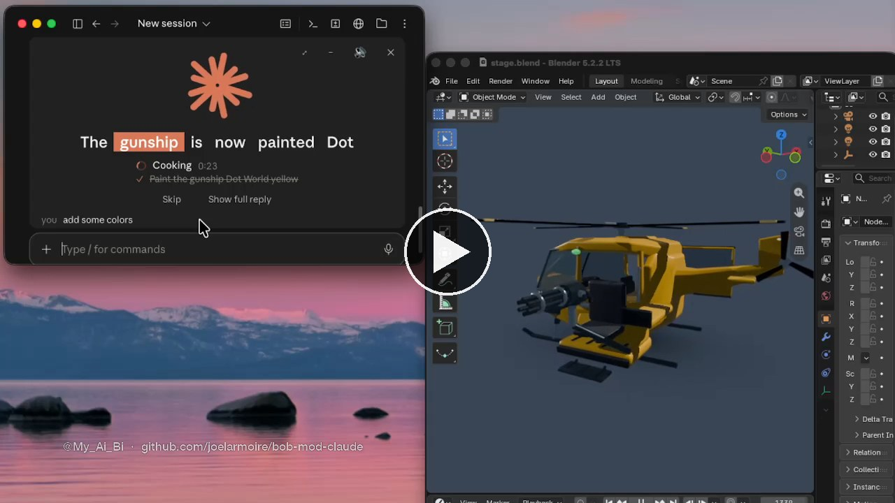

# bob-mod-claude

**Claude talks back.** A mod for the Claude desktop app (Code tab). It says each reply out loud in a few words and shows it as big captions, with the spoken word highlighted. You glance, you hear the gist, you keep working. The full reply is still in the chat when you want it.

> **Beta.** bob-mod-claude reads you the gist of each reply and puts questions and approvals in a panel, so you don't have to read everything. It can leave out details. For anything important, like code changes, warnings or costs, glance at the full reply in the chat.

## See it

[](media/demo.mp4)

Claude finishes a 3D helicopter in Blender, paints it, uploads it to a game and plans a police chase. The mod says each step in a few words, and questions and approvals are answered from the panel. (2:29, sound on.)

## What it does

- **Speaks the point, not the wall of text.** Each reply becomes one or two short spoken lines; short replies are said word for word.
- **Captions, one phrase at a time,** with the word being spoken highlighted.
- **Clear states:** working, QUESTION FOR YOU, NEEDS YOU and DONE, each with its own tag and sound.
- **Answer from the panel.** Questions show as buttons, one at a time. Permission prompts get Allow and Deny. Plans get Approve and Keep planning.
- **Copy and Open.** A command in the reply gets a Copy button; a file or page Claude opened gets an Open button.
- **Live status:** what Claude is doing right now, its task list and any helpers running.
- **Two chats at once:** one talks while the other waits its turn.
- **🔇** mutes everything at once.

## Install

At the prompt of a terminal `claude` session:

```
/plugin install bob-mod-claude --marketplace joelarmoire/bob-mod-claude
```

Answer `y` to add the marketplace, then pick a scope (Enter for your user). From a shell:

```
claude plugin install bob-mod-claude --marketplace joelarmoire/bob-mod-claude
```

In the desktop app, where `/plugin` does not run: click **+** next to the prompt box, then **Plugins**, **Add marketplace** with `joelarmoire/bob-mod-claude`, then **Add plugin**.

## Voice

- **With an OpenAI key** it uses OpenAI's live voice (`ash` by default). Put your key in `~/.config/bob/openai.env`:

  ```
  OPENAI_API_KEY=sk-...
  ```

  The key is read from that file only and is never printed. Node must be installed (`node` on your PATH).
- **Without a key** it uses the Mac's built-in voice, so it works out of the box.

## Commands

`/bob on` · `/bob off` · `/bob voices` (hear the voices) · `/bob voice <name>` · `/bob style` · `/bob sync earlier|later` · `/bob skip` · `/bob all`

## How it works

1. **It listens to the chat.** As Claude writes, each message comes in (`session.append`) and is split into caption lines. Tool calls (`tool.call`) tell it what Claude is doing, and the task list follows Claude's plan updates.
2. **It finds the gist.** When a turn ends (`turn.complete`), a small, fast model (Claude Haiku) sums the reply up in a line or two and pulls out any question and its options.
3. **It speaks.** Each line goes to OpenAI's live voice, streamed so it starts at once. The voice reports when each word is spoken, so the captions highlight in sync. With no key, the Mac's own voice reads it.
4. **It draws the panel** above the message box (`ui.render` for `AbovePrompt`): the orb, the captions, the status, and the card with the reply, the buttons and the time.
5. **It answers for you.** Claude's questions, permission prompts and plan approvals are caught as they happen (`classic.PermissionRequest`), shown as buttons, and your click goes back to Claude exactly as the app's own dialog would send it.
6. **It keeps itself visible.** The app's own "next step" box would cover the panel, so a short note in Claude's instructions (`prompt.compose`) asks it to put questions in plain words instead.

## The code

| File | What it holds |
|---|---|
| `.claude-plugin/plugin.json` | The mod's name, version and its one option (the voice). |
| `.claude-plugin/marketplace.json` | Makes this repository installable with one line. |
| `hooks/register.tsx` | The whole mod. The hooks are at the bottom (`register`); above them are the pieces they use. |
| `helpers/realtime-voice.mjs` | Reads one line with OpenAI's live voice and writes a WAV, with the time of each word. Takes are cached in `~/.cache/bob-voice`. |
| `helpers/realtime-stream.mjs` | The streamed version: the voice starts as soon as the first sound arrives. |
| `sounds/*.wav` | The send, working, question and done sounds. |
| `tests/*.test.tsx` | 48 tests covering every feature. Run them with `claude plugin test .` |

Inside `hooks/register.tsx`, the main pieces:

- `addText` takes in each new message. `play` walks the caption lines one by one, and `streamLine` sends a line to the live voice and lights up each word as it is said.
- `summarize` asks the small model for the gist and any question.
- `drawStage` draws the panel, `card` the finished reply, and `askButtons` the answer buttons.
- `panelAskOf` turns a question, permission or plan into buttons. `answerAsk` and `decisionOf` send your answer back.
- `synthesize` and `synthesizeLive` make the voice (OpenAI), and `findKey` finds your key.

## Make it yours

It's all plain code, so change whatever you like:

- **What it says out loud:** the instructions for the spoken summary are `GIST_SYSTEM`, near the top of
  `hooks/register.tsx`. Change the tone, the length or the language.
- **The voice:** `/bob voice <name>`, or the voice option in the plugin's settings; `/bob style` for the delivery.
- **The sounds:** swap the files in `sounds/`.
- **The panel:** its colors (`CLAUDE_ORANGE`) and the "working" words (`IDLE_WORDS`) are in `hooks/register.tsx`.

After a change, `claude plugin test .` checks that everything still works.

## Requirements

macOS and the Claude desktop app.
