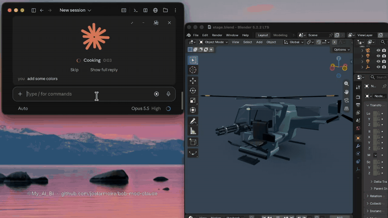

# bob-talks-back: a mod for Claude

**Claude talks back.** A mod for the Claude desktop app (Code tab). It says each reply out loud in a few words and shows it as big captions, with the spoken word highlighted. You glance, you hear the gist, you keep working. The full reply is still in the chat when you want it.

**Install in one step:** copy this, send it to Claude (the desktop app's Code tab, or Claude Code in a terminal), and allow the command when it asks.

```text
Install the Claude mod bob-talks-back for me. Run:

"${CLAUDE_CODE_EXECPATH:-claude}" plugin install bob-talks-back \
  --marketplace joelarmoire/bob-mod-claude

Then tell me to type /reload-plugins (or open a new chat): from my
next message Claude talks back, with the Mac's free voice.

Only if I ask for it later:
- The OpenAI voice: send me to https://platform.openai.com/api-keys,
  run: mkdir -p ~/.config/bob && touch ~/.config/bob/openai.env
  && open -e ~/.config/bob/openai.env
  and tell me to paste OPENAI_API_KEY=my-key there and save (never
  in the chat), then to type /bob normal (cheaper) or /bob live
  (the voice in the demo).
- Talking to Claude with the 🎙 button: run
  brew install ffmpeg whisper-cpp && mkdir -p ~/.config/bob && curl -L
  -o ~/.config/bob/ggml-base.en.bin https://huggingface.co/ggerganov/whisper.cpp/resolve/main/ggml-base.en.bin
```

> **Beta.** bob-talks-back reads you the gist of each reply and puts questions and approvals in a panel, so you don't have to read everything. It can leave out details. For anything important, like code changes, warnings or costs, glance at the full reply in the chat.

## See it



Claude finishes a 3D helicopter in Blender, paints it, uploads it to a game and plans a police chase. The mod says each step in a few words, and questions and approvals are answered from the panel.

**Full demo with sound (2:29).** The demo uses OpenAI's live voice (`/bob live`); out of the box the mod speaks with the Mac's own free voice.

https://github.com/user-attachments/assets/7d6c1697-c564-4a9c-ba90-70a0a1e5eb8b

## What it does

- **Speaks the point, not the wall of text.** Claude writes its own one or two spoken lines for each reply and hands them to the mod's panel tool, so nothing extra shows in the chat and the line comes from the Claude that knows your conversation. Short replies are said word for word, and a question is asked once, never repeated.
- **Captions, one phrase at a time,** with the word being spoken lit up exactly as the voice says it, the Mac's voice included.
- **Clear states:** working, QUESTION FOR YOU, NEEDS YOU and DONE, each with its own tag and sound, and a soft heartbeat every few seconds while Claude works.
- **Nothing stays hidden in the chat.** What you click comes first on the card, right under the line: answer buttons, **Open** for files and pages, **Copy** cards named by Claude (with **Show**), and **Full reply**, which opens the whole reply right in the panel with **Copy all**. Up to 3 short points follow. When the reply truly has to be read (steps to follow, a long list), the voice says so and an orange **Must read** button says why.
- **Answer from the panel.** Questions show as buttons. Permission prompts get Allow and Deny. Plans get Approve and Keep planning.
- **Talk to Claude with 🎙.** Click it (it turns 🔴 and the orb turns red), talk, click it again: what you said lands in the message box for you to send. It's written out on your Mac by Whisper, free and offline, or by OpenAI with your key.
- **🔊 mutes what you choose:** all on, the sounds only, the voice only, or everything.
- **Three voices:** the Mac's own voice, free and on by default, or OpenAI's normal or live voice with your key (`/bob mac`, `/bob normal`, `/bob live`).
- **Live status:** what Claude is doing right now, its task list and any helpers running.
- **Two chats at once:** one talks while the other waits its turn.
- **Stays out of the way:** sessions nobody watches (`claude -p`, scripts) get no voice, sound or panel.

## Install

**Easiest:** send Claude the prompt at the top of this page.

**By hand.** In a terminal:

```
claude plugin install bob-talks-back --marketplace joelarmoire/bob-mod-claude
```

At the prompt of a terminal `claude` session it's `/plugin install bob-talks-back --marketplace joelarmoire/bob-mod-claude`. In the desktop app, where `/plugin` does not run: click **+** next to the prompt box, then **Plugins**, **Add marketplace** with `joelarmoire/bob-mod-claude`, then **Add plugin**.

Then type `/reload-plugins`, or open a new chat. Your next message gets the voice.

**Update:** `claude plugin update bob-talks-back`, then `/reload-plugins`.

## Voice

Three voices. Pick one with a command; the choice is remembered.

| Command | Voice | Cost | Feel |
|---|---|---|---|
| `/bob mac` | The Mac's own voice (**default**) | Free | Works out of the box, nothing to set up. Every word lights up as it's said. |
| `/bob normal` | OpenAI text-to-speech (`gpt-4o-mini-tts`) | Cheap | Natural voice; each line starts a beat later, and the highlight follows its pauses. |
| `/bob live` | OpenAI live voice (`gpt-realtime`) | Costs more | Starts at once, every word lights up as it's said. **This is the voice in the demo.** |

The two OpenAI voices need your OpenAI key in `~/.config/bob/openai.env`:

```
OPENAI_API_KEY=sk-...
```

The key is read from that file only and is never printed. The live voice also needs Node (`node` on your PATH). Without a key, the Mac's voice speaks whatever you picked. `/bob voice <name>` picks the OpenAI voice (`ash` by default) and `/bob voices` plays them.

## Talk to Claude (🎙)

Click 🎙 in the panel's top right, talk, and click it again. It needs `ffmpeg` to record, and then either Whisper on your Mac (free, offline, about half a second) or your OpenAI key:

```
brew install ffmpeg whisper-cpp
mkdir -p ~/.config/bob
curl -L -o ~/.config/bob/ggml-base.en.bin https://huggingface.co/ggerganov/whisper.cpp/resolve/main/ggml-base.en.bin
```

That model understands English. For other languages, put `ggml-small.bin` (or `ggml-large-v3-turbo.bin`) from the same page in `~/.config/bob` instead. macOS asks once whether Claude may use the microphone. The mod picks a real microphone by itself (never a loopback device like BlackHole) and remembers the one that heard you; `/bob mic` lists them and `/bob mic <number>` picks one.

## Commands

`/bob on` · `/bob off` · `/bob mac` · `/bob normal` · `/bob live` · `/bob voices` (hear the OpenAI voices) · `/bob voice <name>` · `/bob mic` · `/bob style` · `/bob sync earlier|later` · `/bob skip` · `/bob all`

## How it works

1. **It listens to the chat.** As Claude writes, each message comes in (`session.append`) and is split into caption lines. Tool calls (`tool.call`) tell it what Claude is doing, and the task list follows Claude's plan updates. A long first sentence is said only up to a point where it still makes sense.
2. **Claude writes the gist.** A short instruction added to Claude's prompt (`prompt.compose`) asks it to call the mod's own `panel` tool right before its final message in each reply (`$.tool.register`) with the tag (Done, Update, Needs you or Question), the line to say out loud, up to 3 points, the names of anything to copy, any options, and whether the full reply must be read. The tool only hands the panel its line: it never asks you for permission and shows as a small collapsed row in the chat. If a reply has no panel call, the mod reads a written note instead (`[bob-tag]` / `[bob-say]` reference lines), then asks a small, fast model (Claude Haiku), and if that doesn't come within 15 seconds, says the end of the reply.
3. **It speaks.** By default the Mac's own voice reads each line (`say`), and reports each word as it says it, so the captions light up exactly in time. With `/bob live`, each line goes to OpenAI's live voice, streamed so it starts at once, with the time of each word. With `/bob normal`, OpenAI's text-to-speech reads it, and the highlight follows the voice's pauses.
4. **It draws the panel** above the message box (`ui.render` for `AbovePrompt`): the orb, the captions, the status, and the card with the reply, the buttons and the time.
5. **It answers for you.** Claude's questions, permission prompts and plan approvals are caught as they happen (`classic.PermissionRequest`), shown as buttons, and your click goes back to Claude exactly as the app's own dialog would send it.
6. **It keeps itself visible.** The app's own "next step" box would cover the panel, so a short note in Claude's instructions (`prompt.compose`) asks it to put questions in plain words instead.
7. **It hears you.** 🎙 records your microphone with `ffmpeg`, Whisper (or OpenAI) writes it out, and `$.prompt.fill` puts it in the message box.
8. **It keeps a history.** Everything said out loud and every question, with its date, goes to `/tmp/bob-talks-back-history.log`, which survives reloads, so you can check afterwards what the panel told you.

## The code

| File | What it holds |
|---|---|
| `.claude-plugin/plugin.json` | The mod's name, version and its one option (the OpenAI voice). |
| `.claude-plugin/marketplace.json` | Makes this repository installable with one line. |
| `hooks/register.tsx` | The whole mod. The hooks are at the bottom (`register`); above them are the pieces they use. |
| `helpers/realtime-voice.mjs` | Reads one line with OpenAI's live voice and writes a WAV, with the time of each word. Takes are cached in `~/.cache/bob-voice`. |
| `helpers/realtime-stream.mjs` | The streamed version: the voice starts as soon as the first sound arrives. |
| `sounds/*.wav` | The send, heartbeat, question, done and tap sounds. |
| `tests/*.test.tsx` | 97 tests covering every feature: each panel case (two things to copy, a choice between plans, sent files, links, a must-read), the Mac voice's word timing, the mute choices, 🎙 with Whisper and with OpenAI, and more. Run them with `claude plugin test .` |

Inside `hooks/register.tsx`, the main pieces:

- `addText` takes in each new message. `play` walks the caption lines one by one; `sayLine` reads a line with the Mac's voice and lights each word as it's said, and `streamLine` does the same with the live voice.
- The `panel` tool's `tool.call` hook takes Claude's line; `noteOf` reads a written note when there is no tool call; `summarize` asks the small model only when there is neither, and `fallbackSummary` uses the end of the reply if that fails too. `closingSentences` decides what is said at the end, and `openingPart` how much of a long first sentence.
- `drawStage` draws the panel, `card` the finished reply with its buttons, points and Full reply, and `askButtons` the answer buttons. `copyNamesOf` and `linksOf` find what to copy and what to open.
- `panelAskOf` turns a question, permission or plan into buttons. `answerAsk` and `decisionOf` send your answer back.
- `micToggle`, `startMic`, `stopMic` and `heardText` are 🎙; `whisperText` and `openAiText` write out what you said.
- `engineOf` says which voice is picked (`/bob mac`, `normal` or `live`). `synthesize` (normal) and `synthesizeLive` (live) make the OpenAI voice, and `findKey` and `openAiKey` find your key.

## Make it yours

It's all plain code, so change whatever you like:

- **What it says out loud:** the instruction that asks Claude for its panel line is `PANEL_TOOL_NOTE` (or `SPOKEN_NOTE`
  for the written note, with `NOTE_BY_TOOL = false`), and the small model's fallback instructions are `GIST_SYSTEM`,
  all near the top of `hooks/register.tsx`. Change the tone, the length or the language.
- **The voice:** `/bob mac`, `/bob normal` or `/bob live` for which voice speaks; `/bob voice <name>`, or the voice option in the plugin's settings, for which OpenAI voice; `/bob style` for the delivery; `MAC_VOICE` for the Mac's voice (Daniel by default).
- **The sounds:** swap the files in `sounds/`.
- **The panel:** its colors (`CLAUDE_ORANGE`) and the "working" words (`IDLE_WORDS`) are in `hooks/register.tsx`.

After a change, `claude plugin test .` checks that everything still works.

## Requirements

macOS and the Claude desktop app (or Claude Code in a terminal). For the OpenAI voices, an OpenAI key; for 🎙, `ffmpeg` plus Whisper or the key.
